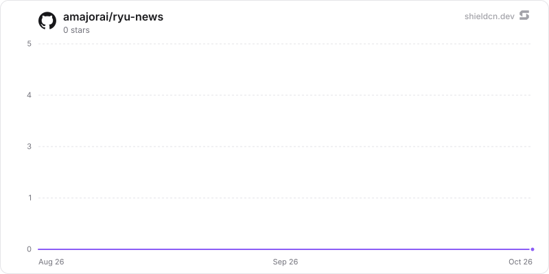

<div align="center">

# news

</div>

A personal newsroom: RSS/Atom/JSON-Feed ingest with conditional GET and per-source backoff, two-layer dedupe (URL canonicalization plus a banded SimHash over content shingles), cross-outlet clustering so the unit you read is an event with n sources, burst detection and explainable ranking.

> **The public home of `ryu-news`.** Source, builds, and releases live here —
> binaries for every platform are attached to each release.
>
> This tree is generated from the Ryu monorepo, so commits pushed here
> directly are replaced on the next sync. **Pull requests are welcome** —
> open them here and they are ported into the monorepo, then flow back out.
> Ryu as a whole: https://github.com/amajorai/ryu

## Install

**App:** [Install](ryu://apps/com.ryu.news) (opens the Ryu desktop app and asks you to confirm)

**CLI:**

```bash
ryu apps add com.ryu.news
```

**From source:**

```bash
cargo build --release --manifest-path backend/Cargo.toml
```

Prebuilt binaries for every platform are attached to [each release](https://github.com/amajorai/ryu/releases).

## License

Apache-2.0 — see [LICENSE](./LICENSE).

## What it does, concretely

- **Sources.** RSS, Atom and JSON Feed parsed natively, with conditional GET (`ETag` /
  `Last-Modified`), exponential backoff on failure, and a source marked `failing` in the UI
  after three consecutive misses rather than quietly going silent. Feed-less or truncated
  sources go through the `web.extract` capability. OPML in and out.
- **Dedupe, twice.** URLs are canonicalized (redirects followed, `utm_*` and friends
  stripped, query pairs sorted) and content is fingerprinted with a 64-bit SimHash over word
  shingles, banded for fast lookup. That is what catches syndicated wire copy running under
  a different headline on six different sites — the single biggest source of feed noise.
- **Stories, not articles.** Articles are clustered across outlets by shingle similarity,
  entity overlap and title overlap inside a rolling window. The unit you read is a story
  with *n* sources attached, so "eight outlets are covering this, and here is how their
  framing differs" is a thing you can see rather than infer.
- **A brief you can audit.** The scheduled digest writes two sentences per cluster with the
  source links, and the raw cluster stays inspectable underneath it. Cluster titling and
  brief prose are the *only* two places a model is involved.
- **Watches that fire for a reason.** A topic is a real boolean query (`AND` / `OR` /
  `NOT`, phrases, and field scoping like `title:` or `source:`), parsed to an AST and
  evaluated against tokenized text, not substring-matched. It refuses to save on a parse
  error, with the column, because a watch that silently matches nothing is worse than one
  that will not save.
- **Breaking, defined.** Burst detection compares a topic's hourly volume against a baseline
  built from *the same hour of day* over the trailing week, because news has a daily cycle
  and a flat baseline just fires every weekday morning. An alert carries its z-score and the
  articles that caused it.
- **Ranking you can interrogate.** Recency half-life × source count × topic match × unread.
  Every factor is displayable, so the feed can answer "why is this at the top".

## How it uses the rest of Ryu

- **Agents ground in *your* corpus.** The app ships an MCP server: `news.search` queries
  the local, vetted, already-deduplicated corpus with no web call at all, and `news.brief`,
  `news.story` and `news.topics` round it out. An agent answering "what happened with X
  this week" can read the feed you curated instead of running a fresh web search and
  trusting whatever comes back.
- **Ground a message in the news.** Turn on *Ground in news* in the composer and a
  `pre_user_turn` hook attaches the top matching recent items as context before the message
  is sent.
- **Events worth routing.** `brief.ready`, `topic.breaking` and `story.developing` are
  declared `hook_events`, so notifications, the Inbox and workflows can bind to them.
- **Extraction** is a capability request, not a dependency on a particular scraper.

## Architecture

`apps-store/news/` is a self-contained satellite. `backend/` is the `ryu-news` sidecar
binary (axum + rusqlite, no lib target, no dependency on `apps/core`), reached through the
generic ext-proxy at `/api/news/*`. `ui/` is the sandboxed companion
(`vite-plugin-singlefile`, CSP `connect-src 'none'`), which talks to its own sidecar through
one generic forwarder rather than a verb per endpoint. The only thing that lands in Core is
the registration.

## Privacy

Sources, articles, clusters and read state live in the node's own SQLite database. Fetches
go to the sources you added and nowhere else — there is no aggregator in the middle, no
account, and no reading history leaving the machine. The clustering, dedupe, burst and
ranking math never calls anything.

## At rest

`news.db` seals what the user chose and wrote per value (`encb:v1:`, store `news.db`, bound to
`<table>.<column>` and the row id) under the `@ryu/news` plugin subkey Core delivers to the
sidecar (`crypto:seal` in the sidecar's `host_api.grants`): `sources.title/feed_url/site_url/
last_error` (a private feed URL can carry a token), `topics.name/query/ast` (the watches),
`stories.title/summary/entities` and `briefs.items`. Writes seal through the `ryu_seal` SQL
function and reads open through `ryu_open` (`src/seal_sql.rs`). The two uniqueness rules on
sealed columns use keyed blind tokens instead (`sources.feed_url_bi`, `topics.name_bi`:
`bi1:` + HMAC under the same subkey, schema v2), so subscribing to a feed twice or saving a
second watch of one name is still a no-op decided by a UNIQUE index; the tokens reveal only
which rows share a value. The source and watch lists sort by title and name after opening.
Articles are copies of public feed items and stay plaintext (their canonical URL and guid carry
the deduplication indexes, and the matcher and ranker read their text), as do read, saved and
archived marks, story counts, the SimHash bands and the settings. Legacy plaintext rows are
sealed and tokenized when the store opens (resumable, idempotent), then the WAL is truncated
and freed pages are zeroed (`secure_delete` is on). A row that does not open is left out of
lists and counted (`/health` `sealing.unreadable_rows`). Key states (`backend/src/seal_keys.rs`):

- **Compat mode**: under an older Core that delivers no key, a never-sealed store keeps working
  in plaintext (the token columns hold the value itself) and `/health` reports
  `sealing.state = "compat"` ("waiting for a Ryu update").
- **No key or another key for a sealed store**: `sealing.state = "unhealthy"`, writes are
  refused and the data is kept.
- **Standalone** (no `RYU_PLUGIN_DATA_DIR`): `RYU_MASTER_KEY` if set, else a generated root in
  `<plugin data dir>/secrets/standalone-root.key` (0600) whose key check value is pinned.
- **`ryu-news mcp`** gets no key (Core delivers keys to sidecars only). It runs every tool
  inside the running sidecar (`ryu_sidecar_runtime::handoff`, re-exported as
  `src/sidecar_link.rs`): at start the sidecar writes
  `<plugin data dir>/secrets/sidecar-handoff.json` (0600) with its loopback port and a random
  token minted for that run (never the Core ext token; replaced at every start, removed on
  shutdown). That token opens only `POST /_handoff/mcp/call`, outside the Core-proxied mount.
  When no sidecar answers (it is lazy and stops when idle), the MCP server opens the store
  itself, never generates a standalone root, re-checks the store record before each call, and
  against a sealed store refuses and asks to open News first.

The standalone satellite mirror builds `ryu-crypto` from crates.io at the declared version, so
the release train that ships this must publish `ryu-crypto` first (already ordered before app
backends in `tools/publish-crates.sh`).

## Star History

<a href="https://github.com/amajorai/ryu-news/stargazers">
  <picture>
    <source media="(prefers-color-scheme: dark)" srcset="./.github/shieldcn/star-chart-dark.svg" />
    
  </picture>
</a>
